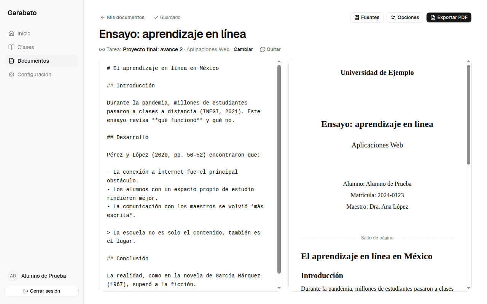
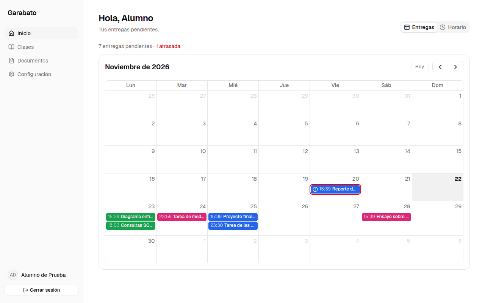
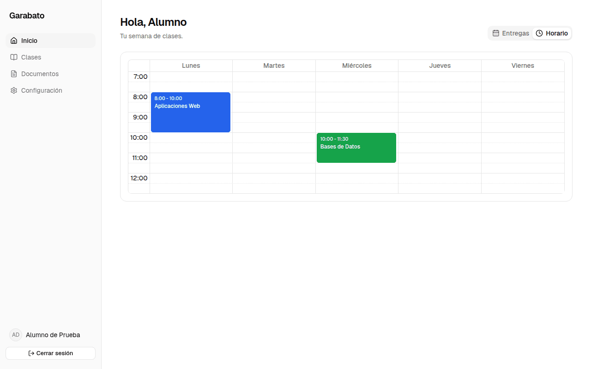
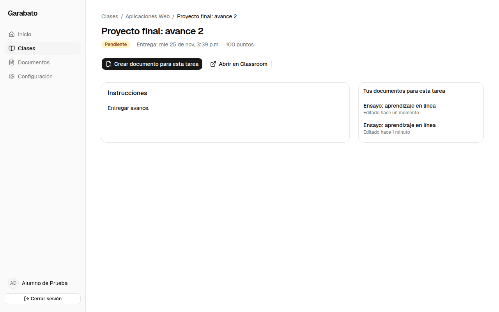
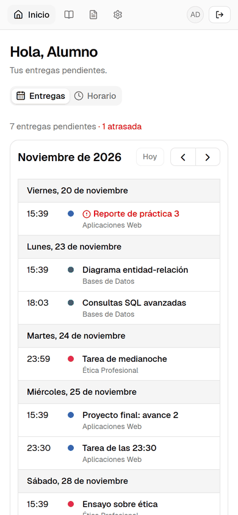
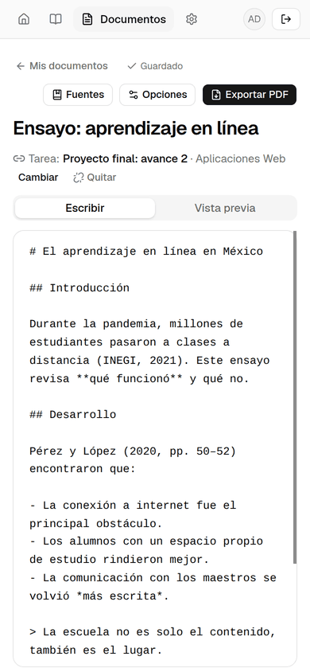
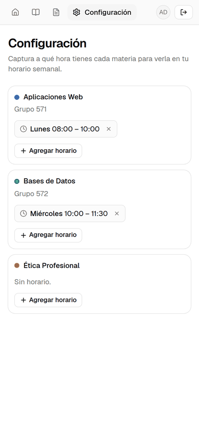

# Garabato

Garabato es una aplicación web de edición de texto basada en Markdown, diseñada específicamente para estudiantes. Su propósito central es centralizar y optimizar el flujo de trabajo académico, unificando en una sola plataforma la creación de documentos, la gestión de tareas y el calendario de Google Classroom.

A diferencia de otros editores de texto, Garabato se distingue por su enfoque en la personalización de documentos (portadas, encabezados, pies de página) para lograr una presentación profesional, y por su capacidad de exportación a PDF respetando todos los ajustes realizados.

**En línea:** <https://garabato-olive.vercel.app> (solo para las cuentas registradas como usuarios de prueba en Google).



## Qué hace

- **Inicio de sesión con Google** y lectura de tus clases y tareas de Google Classroom (solo lectura).
- **Calendario de entregas** con un color por materia y las tareas atrasadas marcadas, y **horario semanal** que capturas en Configuración.
- **Editor de Markdown** con vista previa en vivo y guardado automático. Cada documento se puede vincular a una tarea de Classroom.
- **Formato del documento:** portada con logo, encabezado, pie, numeración de páginas, tamaño carta o A4, tipo de letra e interlineado.
- **Fuentes en APA 7:** agregas libros, artículos o páginas web, insertas la cita donde está el cursor y la sección "Referencias" se genera sola, en orden alfabético.
- **Exportar a PDF** con todo lo anterior (Paged.js).
- Funciona en celular y respeta el modo oscuro del sistema.

| Entregas | Horario | Tarea |
| --- | --- | --- |
|  |  |  |

| Celular: entregas | Celular: editor | Celular: horario |
| --- | --- | --- |
|  |  |  |

## Stack

| Parte | Tecnologías |
| --- | --- |
| Frontend | React 19, Vite, React Router 7, Tailwind CSS 4 con shadcn/ui, react-markdown, FullCalendar 6, Paged.js |
| Backend | Node.js 24, Fastify 5, `@fastify/oauth2` (Google con PKCE), `@fastify/secure-session`, API de Google Classroom |
| Base de datos | PostgreSQL en Neon (`dev` para desarrollo y `prod` para producción) |
| Despliegue | Vercel (frontend) y Render (backend) |

## Estructura

```
backend/
  src/
    server.js        arranque de Fastify y registro de rutas
    config.js        variables de entorno
    db.js            conexión a PostgreSQL y creación de tablas
    plugins/         sesión, requireAuth y CORS
    modulos/         auth, classroom, documentos y horarios (rutas + servicio)
frontend/
  src/
    paginas/         una por ruta: Inicio, Clases, Materia, Tarea, Documentos, Editor, Imprimir…
    componentes/     piezas compartidas; ui/ son los componentes de shadcn
    utils/           APA, opciones del documento, horario, fechas…
    api.js           todas las llamadas al backend
docs/capturas/       imágenes de este README
```

## Correr localmente

Requisitos: Node.js 24 y pnpm (`corepack enable` o `npm install -g pnpm`).

```bash
# Backend (http://localhost:3000)
cd backend
cp .env.example .env   # y llena los valores
pnpm install
pnpm dev

# Frontend (http://localhost:5173), en otra terminal
cd frontend
pnpm install
pnpm dev
```

El frontend redirige `/api` y `/auth` al backend con el proxy de Vite.

## Despliegue

```
Navegador ──► Vercel (frontend) ──/api, /auth──► Render (backend) ──► Neon (prod)
```

Vercel sirve la app y reenvía `/api` y `/auth` a Render (`frontend/vercel.json`). Para el navegador todo está en el mismo dominio, así que la cookie de sesión funciona sin CORS.

### 1. Neon

En el proyecto de Neon, abre la base `prod` → **Connect** y copia la cadena de conexión. Cambia el final a `?sslmode=verify-full&channel_binding=require`. Las tablas se crean solas la primera vez que arranca el backend.

### 2. Render (backend)

1. **New → Blueprint** y elige este repositorio. Render lee `render.yaml` y crea el servicio `garabato-api` (Node 24, región Ohio, carpeta `backend`, health check en `/api/health`). `SESSION_SECRET` se genera solo.
2. Captura las variables que pide:
   - `DATABASE_URL`: la de `prod` del paso 1.
   - `GOOGLE_CLIENT_ID` y `GOOGLE_CLIENT_SECRET`: las mismas de desarrollo.
   - `GOOGLE_REDIRECT_URI`: `https://<tu-proyecto>.vercel.app/auth/callback`. Si todavía no sabes el dominio de Vercel, pon el que esperas y corrígelo después del paso 3.
3. Cuando termine, abre `https://garabato-api-brzf.onrender.com/api/health`: debe responder `{"ok":true}`. Si Render le dio otra URL al servicio, cámbiala en los dos `destination` de `frontend/vercel.json`.

### 3. Vercel (frontend)

**Add New → Project**, importa el repositorio y en **Root Directory** elige `frontend`. Lo demás ya está en `vercel.json` (pnpm, build y rewrites). Al terminar, anota el dominio (`https://<tu-proyecto>.vercel.app`).

### 4. Google Cloud

- **APIs y servicios → Credenciales →** tu ID de cliente OAuth **→ URI de redireccionamiento autorizados**: agrega `https://<tu-proyecto>.vercel.app/auth/callback` (deja también la de `localhost`).
- **Pantalla de consentimiento → Usuarios de prueba**: agrega los correos que van a usar la app.
- Revisa que `GOOGLE_REDIRECT_URI` en Render sea exactamente la misma URI.

### Notas

- El plan gratis de Render se duerme tras 15 minutos sin uso: la primera petición puede tardar cerca de un minuto. Mientras tanto la app muestra un aviso y reintenta las consultas sola (`frontend/src/api.js`).
- Mientras la app esté en modo de prueba en Google, la sesión con Google vence cada 7 días y hay que volver a iniciar sesión.
- El inicio de sesión solo funciona en el dominio de producción de Vercel, no en los deploys de vista previa (su URI no está registrada en Google).

## Demo

Render se duerme tras 15 minutos sin uso, así que conviene prepararla así:

1. **10 minutos antes**, abre <https://garabato-olive.vercel.app> e inicia sesión para que el servidor despierte. Si tarda, la app muestra un aviso y reintenta sola.
2. Revisa que el calendario muestre tareas de Classroom y que el horario tenga tus clases (Configuración).
3. Ten listo un documento de ejemplo vinculado a una tarea, con portada, encabezado, numeración y dos o tres fuentes APA ya citadas.
4. Recorrido sugerido:
   1. Inicio: entregas y horario.
   2. Clases → una materia → una tarea → "Crear documento para esta tarea".
   3. Editor: escribir, ver la vista previa, cambiar opciones y agregar una fuente con su cita.
   4. Exportar PDF.
   5. Abrir la app en el celular.
5. Plan B: ten descargado el PDF del documento de ejemplo por si falla la red.

